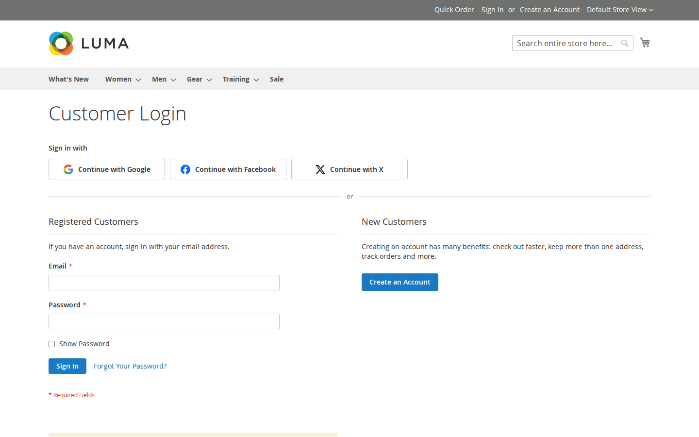

# Softaware Social Login for Magento 2

Lets customers sign in and register with **Google, Facebook and X (Twitter)**. OAuth 2.0 and OpenID Connect are
implemented directly on Magento's HTTP client and PHP's OpenSSL extension; no provider SDKs or JWT libraries are
installed. Works with Luma-based themes and Hyvä.

Package `softaware/module-social-login`, module `Softaware_SocialLogin`.



## Demo and documentation

- Storefront demo: [Luma](https://demo.softawarecommerce.com/customer/account/login/) ·
  [Hyvä](https://demo.softawarecommerce.com/hyva/customer/account/login/)
- Admin demo: https://demo.softawarecommerce.com/try-admin/social-login
- Product page (free): https://softawarecommerce.com/shop/magento-2-extensions/social-login-for-magento-2/
- [User guide](docs/user-guide.md) (installation, settings, provider setup, troubleshooting) · [FAQ](docs/faq.md) ·
  [Changelog](CHANGELOG.md)

## Features

- **Providers**: Google (OpenID Connect + PKCE), Facebook (Graph API with `appsecret_proof`), X / Twitter (OAuth 2.0
  with PKCE). Each: enable, client ID, secret (stored encrypted), button label, sort order. The exact callback URL
  for the selected store view is shown under each provider in the configuration.
- **Where**: sign-in page, create-account page, Luma authentication popup ("Checkout using your account"), the
  "Sign In" link on the checkout page, the checkout email step (optional), Hyvä authentication popup, CMS widget
  **Softaware Social Login Buttons**, and a layout block (`Softaware\SocialLogin\Block\Buttons`).
- **Look**: icon and text, or icon only; light or dark. Sign-in in a **popup window** or a **full-page redirect**.
- **In-app browsers**: in the built-in browsers of Instagram, Facebook and other apps (where Google blocks OAuth
  sign-in) a note above the buttons asks the shopper to open the page in their browser, with a "Copy link" button.
  Detected in the browser (full page cache safe); Luma, checkout and Hyvä.
- **Security**
  - `state` (random, single use, stored server-side, bound to the browser by a cookie, 15-minute lifetime),
    `nonce` (OIDC) and PKCE S256 (Google, X).
  - Google ID tokens are validated against Google's JWKS (RS256/ES256, `alg` whitelist, issuer, audience, expiry,
    nonce). Keys are cached and refreshed on rotation.
  - Email addresses are only treated as verified when the provider says so (`email_verified`, X
    `confirmed_email`). Typed-in addresses never count as verified.
  - Signing in to an EXISTING account by email (without its password) additionally requires that the provider
    is responsible for the address: Google only for Gmail and Google Workspace addresses (as Google advises), X
    for its confirmed addresses. Facebook addresses always ask for the password once.
  - New accounts from an unverified address must be confirmed with Magento's confirmation email before they can
    be used, even when the store does not require confirmation (protects against "pre-account hijacking").
  - The session id is regenerated on every sign-in (Magento's `setCustomerDataAsLoggedIn()`).
  - Callback is CSRF-safe through the state; all customer-side state changes use POST with form key.
  - Return URLs are restricted to this installation and parsed strictly (no open redirect). Secrets, codes and
    tokens are never logged.
- **Account matching**
  - An identity that is already linked signs in its customer.
  - An existing customer with the same, **trusted** email (see Security) is linked automatically, or
    (configurable) only after entering the account password. Other emails always require the password.
  - New customers are created with name and email from the provider, in a configurable customer group, with an
    optional welcome email ("Welcome Email (without password)" template). Addresses the provider has not verified
    get Magento's confirmation email instead; the account can be used once it is confirmed.
  - **Create New Accounts** can be switched off: then only existing customers can sign in with a provider.
  - Works with Softaware Customer Approval: social sign-ups get an approval status like any registration, and
    pending or rejected customers are not signed in (they see the approval message).
  - When the provider returns no email (X without the email permission) or no name, the customer completes a
    short form.
- **My Account > Connected Accounts**: see linked providers, connect another, disconnect. Disconnecting is refused
  when it would leave the customer without a way to sign in (no password and no other provider).
- **Admin**: Softaware > Social Login > Linked Accounts (grid with filters, remove links); "Social Login" tab on
  the customer edit page; ACL for viewing, removing and configuration.
- **GDPR**: links are deleted together with the customer (foreign key `ON DELETE CASCADE`). Pending sign-in data is
  deleted after 15 minutes (cron).
- **Test provider** (development only): a local identity provider to try the whole flow without provider apps.
  Disabled by default, works only in developer mode, and its addresses are never treated as verified (new
  accounts made with it therefore need the confirmation email).
- **More providers**: works with **Social Login Pro** (Apple, Microsoft, LinkedIn, Amazon and GitHub), see below.

## Configuration

Stores > Configuration > Softaware > Social Login (`softaware_sociallogin/*`), also reachable from
Softaware > Social Login > Configuration.

| Group | Settings |
| --- | --- |
| General | Enabled, sign-in window (redirect/popup), button style, button colour |
| Where to Show the Buttons | Sign-in page, create-account page, authentication popup and checkout sign-in, checkout email step |
| Accounts | Create new accounts (yes/no), existing account with the same email (link automatically / ask for password), welcome email, customer group, after sign-in (stay on page / My Account / custom URL) |
| Google, Facebook, X | Enabled (with the callback URL), client ID, client secret, button label, sort order; Facebook: Graph API version; X: request email |
| Test Provider | Enabled (developer mode only) |

Scope: default, website and store view (credentials can differ per domain). Provider codes (config group and
callback URL segment): `google`, `facebook`, `twitter` (X), `test`.

### Provider setup in short

Register the callback URL shown in the configuration exactly as displayed (one per store view URL):

- **Google**: Google Cloud console > Google Auth Platform > Clients > Create client (Web application), "Authorized
  redirect URIs".
- **Facebook**: use case "Authenticate and request data from users with Facebook Login" (older apps: Facebook Login product), "Valid OAuth Redirect URIs", `email` permission.
- **X**: User authentication settings, OAuth 2.0, type Web App, callback URL. Switch on "Request email" only if
  the app has the email permission.

### Widget and layout block

Content > Widgets > Add Widget > "Softaware Social Login Buttons" (heading, style, colour). In layout XML:

```xml
<block class="Softaware\SocialLogin\Block\Buttons" name="my.social.buttons">
    <arguments>
        <argument name="place" xsi:type="string">widget</argument>
        <argument name="title" xsi:type="string">Sign in with</argument>
    </arguments>
</block>
```

The block picks the Luma or Hyvä template automatically and hides itself for signed-in customers in the
browser, so it can be used on full-page-cached pages.

## Social Login Pro

The add-on **Social Login Pro** (`softaware/module-social-login-pro`) adds Sign in with Apple, Microsoft (Entra ID),
LinkedIn, Amazon and GitHub. Its providers appear in the same configuration section, the same button rows, the
Connected Accounts page and the admin tools, and use the same settings described here. Product page:
https://softawarecommerce.com/shop/magento-2-extensions/social-login-pro-for-magento-2/

## Adding a provider (developers)

The module is built to be extended by other modules:

| Extension point | How |
| --- | --- |
| Provider | Implement `Softaware\SocialLogin\Model\Provider\ProviderInterface` (or extend `AbstractProvider` / `AbstractOidcProvider`) and add it to the `providers` argument of `Softaware\SocialLogin\Model\Provider\ProviderPool` in your `di.xml`. Providers that need more services declare their own constructor arguments and pass `ProviderContext` on to the parent. |
| Settings | Add a group with the provider code as id to section `softaware_sociallogin` in your `etc/adminhtml/system.xml`; values are read from `softaware_sociallogin/<code>/...` (`enabled`, `client_id`, `client_secret`, `label`, `sort_order`). |
| Callback URL in the admin | A virtual type of `Softaware\SocialLogin\Model\Config\Comment\CallbackUrl` with the arguments `providerCode` and `hint`, used as the comment model of the group's `enabled` field. |
| Button icon | Add an inline SVG (as a class constant) to the `icons` argument of `Softaware\SocialLogin\ViewModel\ProviderIcons`. Codes without an icon get a neutral one. |
| Self-test | Implement `Softaware\SocialLogin\Model\SelfTest\CheckInterface` and add it to the `checks` argument of `Softaware\SocialLogin\Console\Command\SelfTestCommand`. |

Links whose provider is not installed (for example after removing a module) are kept and handled safely: the admin
grid, the customer tab and Connected Accounts show them with their provider code, they can always be removed, and
they do not count as a way to sign in when a customer disconnects another provider.

## CLI

```
bin/magento softaware:social-login:links [--customer=<id|email>] [--provider=google] [--limit=50]
bin/magento softaware:social-login:unlink <link_id>
bin/magento softaware:social-login:self-test [--accounts]
```

`self-test` lists the registered providers and checks PKCE (RFC 7636 test vector), ID token validation (RS256 and
ES256) incl. tampering, wrong issuer/audience/nonce, expired tokens and `alg` confusion, the state store, return URL
(open redirect) handling, the email trust rules and, with `--accounts`, the account matching rules using temporary
"Test SocialLogin" customers that are deleted afterwards. Installed add-ons add their own checks. It makes no calls
to providers.

## Compatibility

- Magento Open Source / Adobe Commerce 2.4.7 to 2.4.9, PHP 8.2 to 8.5, ext-openssl.
- Luma, Blank and themes based on them; Hyvä 1.3+ (tested with Hyvä 1.5). The Hyvä checkout uses the Luma
  checkout fallback, so the checkout buttons are the Luma ones.
- Requires `softaware/module-core` ^1.0.

## Limitations

- Real provider sign-ins could not be tested on the development server (no provider apps); the protocol pieces
  are covered by the self-test and the full flow by the test provider.
- Facebook only returns confirmed email addresses, so new accounts need no confirmation; an existing account with
  the same address is only connected after its password is entered once (Facebook gives no verification flag).
  Google addresses outside Gmail/Workspace are handled the same way.
- One identity per provider per customer.
- Callback URLs are per store view URL; with store codes in URLs, register one per store view.
- Customers created through social sign-in have no password until they set one with "Forgot Your Password?".

## Log

`var/log/softaware_sociallogin.log` (failed sign-ins with the technical reason; no secrets or tokens).
