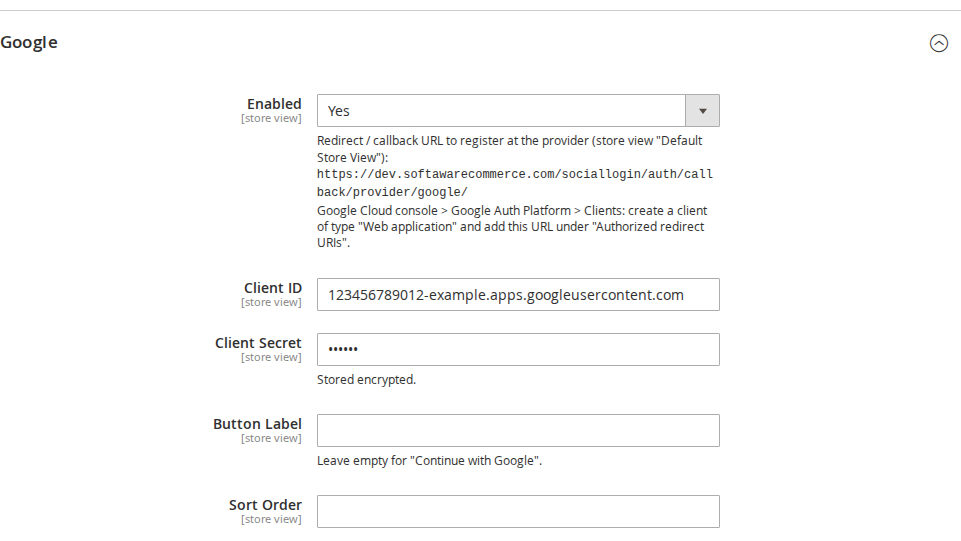
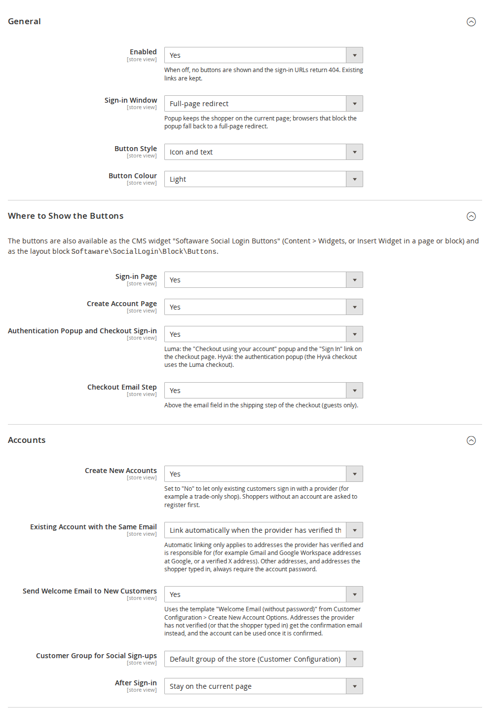
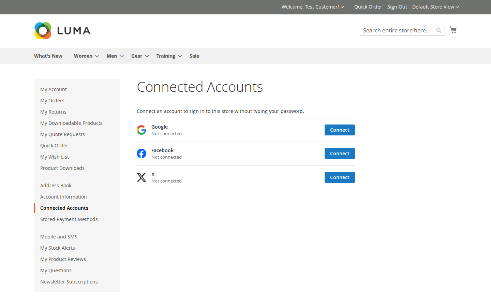
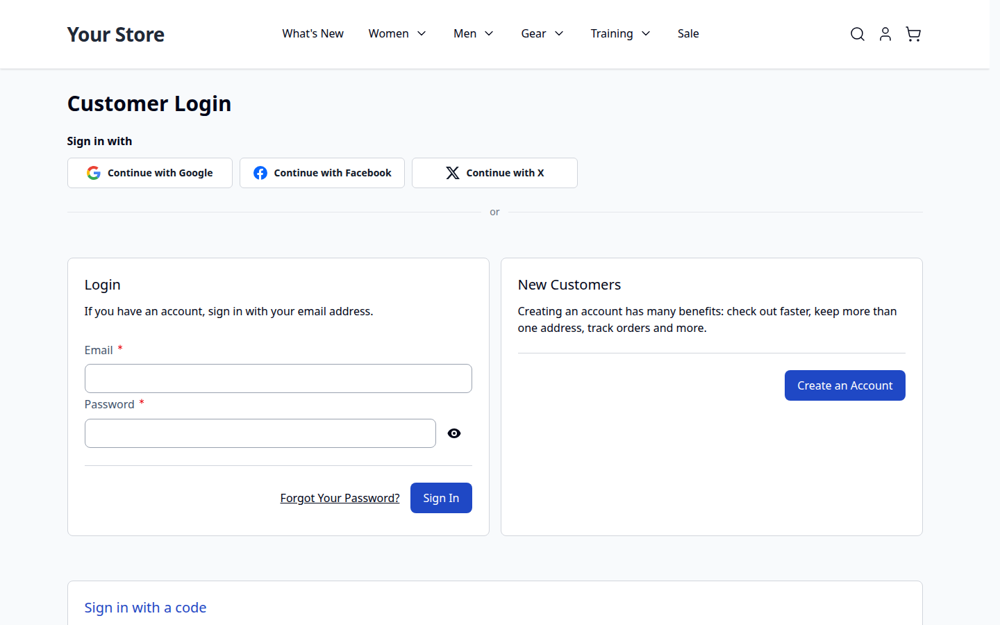
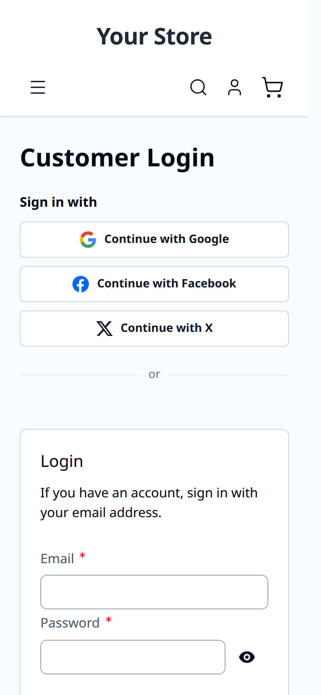

# Social Login for Magento 2 — User Guide

Let customers sign in and register with **Google, Facebook and X (Twitter)** in one click. This guide covers
installation, configuration, provider setup and day-to-day use.

- Demo (Luma): https://demo.softawarecommerce.com/customer/account/login/
- Demo (Hyvä): https://demo.softawarecommerce.com/hyva/customer/account/login/
- Admin demo: https://demo.softawarecommerce.com/try-admin/social-login
- Product page (free): https://softawarecommerce.com/shop/magento-2-extensions/social-login-for-magento-2/
- Changelog: [CHANGELOG.md](../CHANGELOG.md) · Questions: [FAQ](faq.md)


## 1. Requirements

| | |
| --- | --- |
| Magento | Open Source or Adobe Commerce 2.4.7 – 2.4.9 |
| PHP | 8.2 – 8.5 with `ext-openssl` and `ext-json` |
| Themes | Luma, Blank and themes based on them; Hyvä 1.3+ |
| Other | `softaware/module-core` (installed automatically) |

No provider SDKs or JWT libraries are installed: the module talks to the providers through Magento's own HTTP
client and PHP's OpenSSL extension.

## 2. Installation

With Composer (recommended). Social Login is free; get it on the [product page](https://softawarecommerce.com/shop/magento-2-extensions/social-login-for-magento-2/) and use the Composer keys
from your account on softawarecommerce.com (My account > Composer keys, https://softawarecommerce.com/my-modules/keys/):

```bash
composer config repositories.softaware composer https://repo.softawarecommerce.com
composer config --auth http-basic.repo.softawarecommerce.com PUBLIC_KEY PRIVATE_KEY
composer require softaware/module-social-login
bin/magento setup:upgrade
bin/magento setup:di:compile            # production mode only
bin/magento setup:static-content:deploy # production mode only
bin/magento cache:flush
```

On Hyvä, the module's templates are picked automatically. If you build Tailwind CSS from your theme, run your
usual Hyvä build after installing so the button styles are included.

To update later: `composer update softaware/module-social-login`, then the same `bin/magento` commands.

## 3. Quick start (10 minutes)

1. **Stores > Configuration > Softaware > Social Login** (also under **Softaware > Social Login > Configuration**).
2. **General > Enabled = Yes.**
3. Open a provider group, e.g. **Google**, set **Enabled = Yes**. Below the field you now see the
   **callback URL** for the current store view, for example
   `https://www.example.com/sociallogin/auth/callback/provider/google/`.
4. Create an OAuth app at the provider (see section 5), register that callback URL **exactly as shown**, and copy
   the client ID and secret back into Magento.
5. **Save Config** and flush the cache. The buttons appear on the sign-in and create-account pages.



## 4. Settings



All settings can be set per website and store view, so each domain can use its own provider apps.

### General

| Setting | What it does |
| --- | --- |
| Enabled | Switches the whole module on or off. When off, no buttons are shown and the sign-in URLs return 404; existing links between customers and providers are kept. |
| Sign-in Window | **Full-page redirect** or **Popup**. A popup keeps the shopper on the current page; browsers that block it fall back to a redirect. |
| Button Style | Icon and text, or icon only. |
| Button Colour | Light or dark. |

### Where to Show the Buttons

| Setting | What it does |
| --- | --- |
| Sign-in Page | Buttons above the sign-in form. |
| Create Account Page | Buttons above the registration form. |
| Authentication Popup and Checkout Sign-in | Luma: the "Checkout using your account" popup and the "Sign In" link on the checkout page. Hyvä: the authentication popup. |
| Checkout Email Step | Buttons above the email field in the shipping step (guests only). |

The buttons are also available as a CMS widget and a layout block (section 7).

### Accounts

| Setting | What it does |
| --- | --- |
| Create New Accounts | **Yes**: shoppers without an account get one on their first social sign-in. **No**: only existing customers can sign in with a provider (useful for trade-only shops). |
| Existing Account with the Same Email | **Link automatically** when the provider has verified the address and is responsible for it, or **Ask for the password** every time. Other addresses always ask for the account password once. |
| Send Welcome Email to New Customers | Sends the "Welcome Email (without password)" template. |
| Customer Group for Social Sign-ups | The store's default group or a fixed group. |
| After Sign-in | Stay on the current page, go to My Account, or a custom URL. |

### Providers

Each provider has **Enabled**, its credentials (stored encrypted), an optional **Button Label** (empty = "Continue
with …") and a **Sort Order** for the button position.

## 5. Setting up the providers

Register the callback URL shown under the provider's **Enabled** field. With several store views or domains,
register one callback URL per store view URL.

| Provider | Where to create the app | What to enter in Magento |
| --- | --- | --- |
| Google | Google Cloud console > Google Auth Platform > Clients > Create client (Web application); add the callback under "Authorized redirect URIs". | Client ID, Client Secret |
| Facebook | Meta for Developers: add the Facebook Login product, enter the callback under "Valid OAuth Redirect URIs", request the `email` permission. | App ID, App Secret, Graph API version |
| X | X Developer Portal > User authentication settings: OAuth 2.0, type "Web App", callback URL. | Client ID, Client Secret; "Request Email Address" only if the app has the email permission |

## 6. What your customers see

**Signing in or registering.** The customer clicks a button, approves at the provider and is signed in. A new
customer gets an account with the name and email from the provider. If the provider gives no email (X without the
email permission) or no name, the customer fills in a short form once.

**Existing customers.** If a customer with the same email already exists, the identity is linked to that account
(automatically or after the password, see *Accounts*). From then on the provider signs them in directly.

**Unverified addresses.** A new account made from an address the provider has not verified must be confirmed with
Magento's confirmation email before it can be used, even if your store does not normally require confirmation.

**Connected Accounts.** Under **My Account > Connected Accounts** customers see their linked providers, connect
another one or disconnect one. Disconnecting is refused when it would leave the account without any way to sign
in (no password and no other provider).



**In-app browsers.** When the shop is opened inside Instagram, Facebook, Messenger, TikTok, LinkedIn, Snapchat,
Pinterest, WeChat, LINE or another app's built-in browser, a note above the buttons asks the customer to open the
page in their browser, with a **Copy link** button. Google does not allow sign-in in these built-in browsers, and
other providers may not work there either. The buttons stay available. The note is detected in the browser, so
cached pages work as usual; it appears on Luma (including the checkout) and Hyvä.

**Hyvä and mobile.** The Hyvä templates are included and the buttons stack on small screens.

| Hyvä | Mobile |
| --- | --- |
|  |  |

## 7. Widget and layout block

**CMS widget:** Content > Widgets > Add Widget > "Softaware Social Login Buttons" (heading, style, colour), or
Insert Widget in a page or block.

**Layout XML:**

```xml
<block class="Softaware\SocialLogin\Block\Buttons" name="my.social.buttons">
    <arguments>
        <argument name="place" xsi:type="string">widget</argument>
        <argument name="title" xsi:type="string">Sign in with</argument>
    </arguments>
</block>
```

The block picks the Luma or Hyvä template automatically and hides itself for signed-in customers in the browser,
so it is safe on full-page-cached pages.

## 8. Admin tools

- **Softaware > Social Login > Linked Accounts**: every link between a customer and a provider, with filters, last
  sign-in and number of sign-ins; remove links singly or in bulk.
- **Customers > edit customer > Social Login** tab: the customer's links.
- **ACL**: separate permissions for viewing links, removing links and the configuration.

Links of a provider that is not installed (for example after removing an add-on) stay visible with their provider
code and can be removed; customers can remove them under Connected Accounts too.

## 9. Command line

```bash
bin/magento softaware:social-login:links [--customer=<id|email>] [--provider=google] [--limit=50]
bin/magento softaware:social-login:unlink <link_id>
bin/magento softaware:social-login:self-test [--accounts]
```

`self-test` lists the registered providers and checks the security pieces (PKCE, ID token validation including
tampered, expired and wrong-audience tokens, return URL handling, email trust rules) without calling any provider.
Installed add-ons such as Social Login Pro add their own checks. With
`--accounts` it also checks the account-matching rules using temporary test customers that are deleted afterwards.

## 10. Privacy (GDPR)

- The module stores only the link between a customer and a provider account (provider, provider user ID, email and
  display name at the provider, link date, last sign-in and number of sign-ins). No access tokens are kept.
- Links are deleted together with the customer.
- Pending sign-in data is deleted after 15 minutes by cron.
- Mention the sign-in providers you use in your privacy policy.

## 11. Troubleshooting

| Problem | Solution |
| --- | --- |
| The buttons do not appear | Check **General > Enabled**, the provider's **Enabled**, client ID and secret for the store view you are looking at, then flush the cache. |
| "redirect_uri_mismatch" or similar at the provider | The callback URL registered at the provider differs from the one shown in Magento (http vs https, www, store code, trailing slash). Copy it again exactly. |
| The popup does not open | The browser blocked it; the module falls back to a full-page redirect. Choose **Full-page redirect** if you prefer. |
| Customer is asked for the password | Expected when the provider has not verified the address or is not responsible for it (see *Accounts*). It happens once; afterwards the provider signs them in directly. |
| Google shows "Access blocked" or `disallowed_useragent` | The customer opened the shop in an app's built-in browser (Instagram, Facebook and others). Google refuses sign-in there; the customer sees a note asking them to open the page in their browser. |
| Sign-in fails | See `var/log/softaware_sociallogin.log` for the technical reason (no secrets or tokens are logged). |

## 12. More providers: Social Login Pro

The add-on **Social Login Pro** (`softaware/module-social-login-pro`) adds Sign in with Apple, Microsoft (Entra
ID), LinkedIn, Amazon and GitHub. After installing it (`composer require softaware/module-social-login-pro`, then
the `bin/magento` commands from section 2), the new providers appear as groups in the same configuration section and
use all the settings in this guide. Its own user guide describes the provider setup. Product page:
https://softawarecommerce.com/shop/magento-2-extensions/social-login-pro-for-magento-2/

## 13. Uninstall

```bash
bin/magento module:disable Softaware_SocialLogin
composer remove softaware/module-social-login
bin/magento setup:upgrade
```

If Social Login Pro is installed, remove it first (`composer remove softaware/module-social-login-pro`).

Customers created through social sign-in keep their accounts; they can set a password with "Forgot Your Password?".
